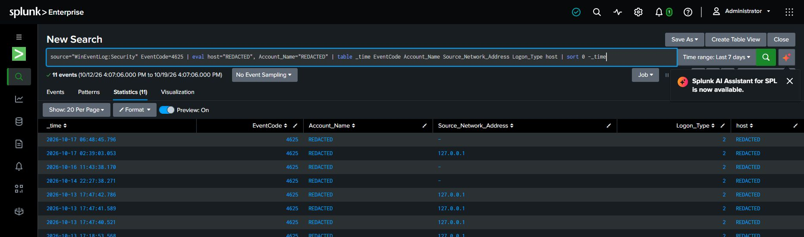
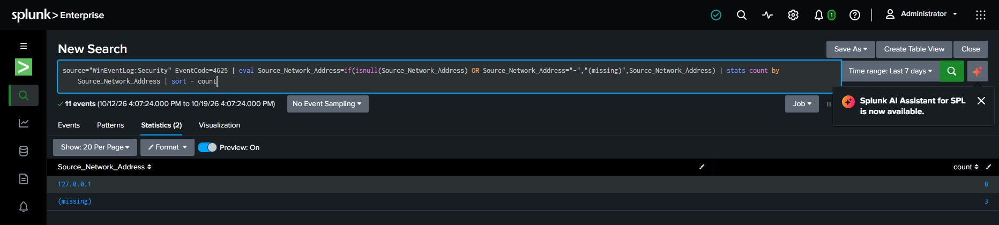

# Investigation 01 — Failed Login Hunt

**Scope:** Review Windows Security EventCode 4625 failures in the local Splunk lab. Findings describe only the captured search windows and fields.

## Scenario

Assess whether observed failures cluster by source and whether context supports further review. A cluster alone does not prove password spraying or compromise.

## Search

The captured seven-day search returned 11 EventCode 4625 events:

~~~spl
source="WinEventLog:Security" EventCode=4625
~~~

The following source aggregation normalizes blank and dash values to the label shown in the screenshot:

~~~spl
source="WinEventLog:Security" EventCode=4625
| eval Source_Network_Address=if(isnull(Source_Network_Address) OR Source_Network_Address="-","(missing)",Source_Network_Address)
| stats count by Source_Network_Address
| sort - count
~~~

## Investigation

Review event time, account, source address, host, logon type, and failure status/substatus in raw records. Compare with authorized lab activity. A separate 30-day correlation search is documented in [Investigation 02](02-authentication-correlation.md); its ten-minute buckets are candidates for review, not proof of an individual failure-success pair.

## Findings and disposition

**Observed result:** The captured seven-day search returned 11 events. The source aggregation groups 8 under loopback address 127.0.0.1 and 3 under a missing address value. Account and host result fields are redacted. The screenshots do not establish distinct account count, timezone, logon type, failure substatus, or an external source.

| Evidence field | Observed value |
|---|---|
| Time range | Last 7 days as displayed in Splunk; timezone not visible |
| Host and target accounts | Redacted in screenshots; distinct account count not established |
| Source addresses | 127.0.0.1 (8); missing value (3) |
| Event count | 11 in the captured search |
| Related 4624 reviewed? | Separate 30-day bucket-level comparison is shown in case 02; individual event pairing is not established |
| Analyst disposition | Descriptive lab telemetry. No malicious activity, compromise, or actor attribution is established; review raw event context before disposition. |

## MITRE ATT&CK

No technique is assigned from this evidence. Password spraying (T1110.003) would require a supported pattern and additional context.

## Evidence

