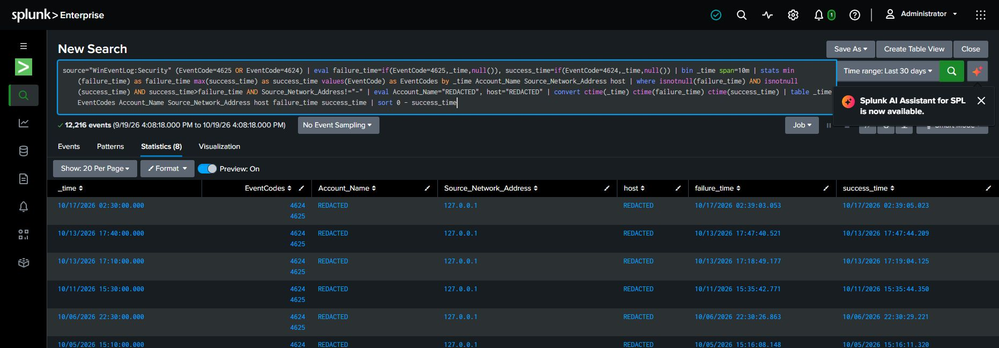

# Investigation 02 — Authentication Correlation

**Scope:** Compare failed and successful Windows logons in a bounded range. Similarity in time or source is a triage lead, not proof of shared actor or cause.

## Captured ten-minute correlation search

This is the search visible in the 30-day screenshot. It retains a candidate bucket only when both event codes are present, the latest success time is later than the earliest failure time, and a source address is present. Account and host values are redacted in the displayed results.

~~~spl
source="WinEventLog:Security" (EventCode=4625 OR EventCode=4624)
| eval failure_time=if(EventCode=4625,_time,null()), success_time=if(EventCode=4624,_time,null())
| bin _time span=10m
| stats min(failure_time) as failure_time max(success_time) as success_time values(EventCode) as EventCodes by _time Account_Name Source_Network_Address host
| where isnotnull(failure_time) AND isnotnull(success_time) AND success_time>failure_time AND Source_Network_Address!="-"
| eval Account_Name="REDACTED", host="REDACTED"
| convert ctime(_time) ctime(failure_time) ctime(success_time)
| table _time EventCodes Account_Name Source_Network_Address host failure_time success_time
| sort 0 - success_time
~~~

For event-level review, inspect the underlying records with a bounded time range and confirm the actual field names:

~~~spl
source="WinEventLog:Security" (EventCode=4625 OR EventCode=4624)
| table _time, EventCode, Account_Name, Source_Network_Address, Logon_Type
| sort _time
~~~

## Findings and disposition

**Observed result:** The captured 30-day view shows 8 qualifying ten-minute buckets containing both 4625 and 4624, with a later success timestamp in each bucket and visible source 127.0.0.1. Account and host result values are redacted. Each result is a bucket-level candidate: it does not establish 8 individual event pairs, sessions, or a shared actor.

| Evidence field | Observed value |
|---|---|
| Time range | Last 30 days as displayed in Splunk; timezone not visible |
| Host/account/source reviewed | Host and account redacted; visible source is loopback 127.0.0.1 |
| 4625 and 4624 observations | 8 displayed ten-minute buckets contain both codes and a later success timestamp |
| Correlation basis / limitations | The query compares the earliest failure and latest success within each ten-minute bucket, grouped by time, account, source, and host. Validate raw events to confirm precise ordering and context. |
| Analyst disposition | Triage candidates only. No malicious activity, compromise, or attribution is established by this view. |

## MITRE ATT&CK

No technique is assigned. Valid Accounts (T1078) would require evidence of unauthorized account use.

## Evidence

