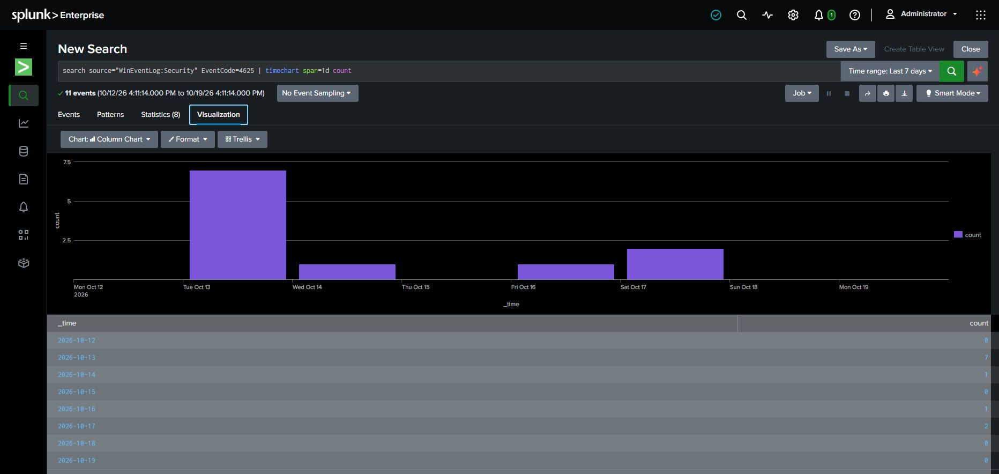

# Investigation 04 — Event Aggregation Analysis

**Scope:** Summarize captured Windows Security 4625 events and compare source counts with a daily time view. Aggregations guide follow-up; they do not replace event-level context.

## Captured searches

Source aggregation shown in the screenshot:

~~~spl
source="WinEventLog:Security" EventCode=4625
| eval Source_Network_Address=if(isnull(Source_Network_Address) OR Source_Network_Address="-","(missing)",Source_Network_Address)
| stats count by Source_Network_Address
| sort - count
~~~

Daily time analysis shown in the screenshot:

~~~spl
search source="WinEventLog:Security" EventCode=4625 | timechart span=1d count
~~~

Both searches use the displayed Last 7 days range.

## Investigation

Compare summaries with the bounded event search. Check missing values and consider host scope, collection, and event context. Do not interpret aggregate counts as attribution.

## Findings and disposition

**Observed result:** The captured window contains 11 events. The source summary groups 8 under 127.0.0.1 and 3 under a missing address. The daily time analysis displays: Oct 12, 0; Oct 13, 7; Oct 14, 1; Oct 15, 0; Oct 16, 1; Oct 17, 2; Oct 18, 0; Oct 19, 0. These displayed daily counts sum to 11.

| Evidence field | Observed value |
|---|---|
| Search and time range | Windows Security EventCode 4625; Last 7 days as displayed (timezone not visible) |
| Grouping fields | Source address for source summary; day for timechart |
| Summary and event-search context | 11 total; 127.0.0.1: 8; missing source: 3. Daily counts: 0, 7, 1, 0, 1, 2, 0, 0 from Oct 12–19, 2026. |
| Data limitations | Loopback is local context, not external attribution. Missing source values remain unknown. Aggregates do not expose account, host, logon type, or event details. |
| Analyst conclusion | Descriptive lab data only. No malicious activity or attack pattern is concluded from these summaries. |

## MITRE ATT&CK

No technique is assigned from aggregation alone.

## Evidence

