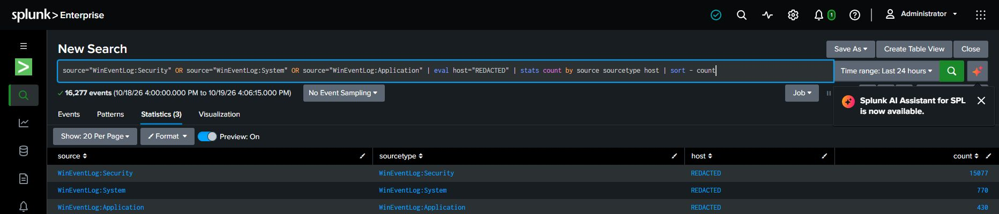
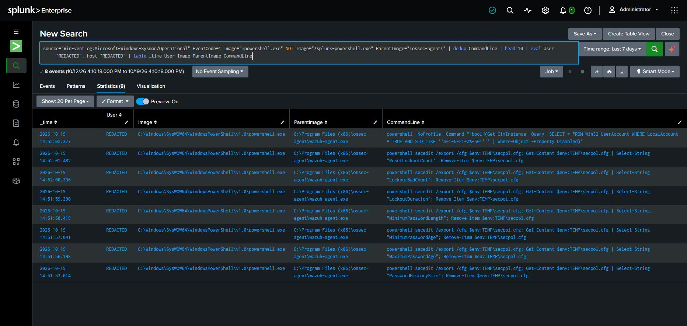

# Splunk Lab Evidence

These genuine captures were taken from the local Splunk Enterprise lab on 2026-10-19. They document the searches and results visible at capture time; they are not tutorial screenshots. The UI header shows the Splunk user as Administrator. Host and account result fields are redacted where present. The loopback address 127.0.0.1 is retained because it is relevant to the local lab results.

## Data ingestion

The last-24-hour source summary shows 16,277 events across Windows Security (15,077), System (770), and Application (430) sources. This confirms events were searchable from these sources during the displayed window; it does not prove complete collection or retention.

## Failed logons

The bounded seven-day EventCode 4625 search returned 11 events. The source aggregation groups 8 under 127.0.0.1 and 3 under a missing address value. A loopback source and missing addresses do not identify an external actor.

## Authentication comparison

The separate 30-day search shows 8 qualifying ten-minute result buckets containing both 4625 and 4624, with a later success timestamp in each bucket and the visible source 127.0.0.1. These are bucket-level temporal co-occurrences, not eight proven event pairs, sessions, or an attribution.

## Sysmon PowerShell process context

The seven-day filtered search shows 8 rows after deduplicating by command line. The displayed PowerShell process is parented by the Wazuh agent and the visible command lines perform local account or security-policy checks. User and host result fields are redacted. This is process telemetry, not evidence of malicious execution.

## Time analysis

The seven-day daily timechart summarizes the same 11 failed-logon events: Oct 12: 0; Oct 13: 7; Oct 14: 1; Oct 15: 0; Oct 16: 1; Oct 17: 2; Oct 18: 0; Oct 19: 0. Counts describe this captured window only.

## Evidence limits

No saved-search or alert configuration is evidenced by these screenshots. The aggregation and correlation views support triage practice only; neither establishes malicious activity, compromise, or attribution. Re-check current Splunk data before reusing these time-specific counts.
